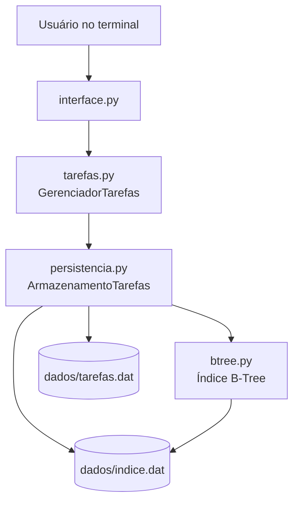
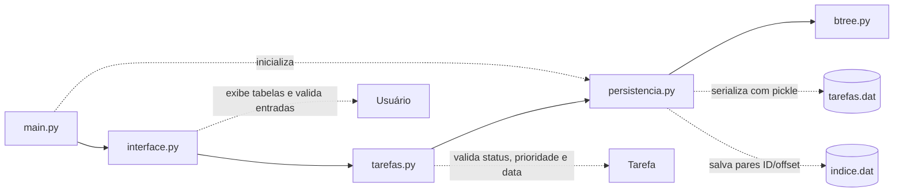
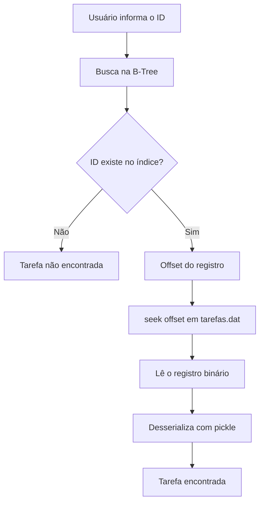
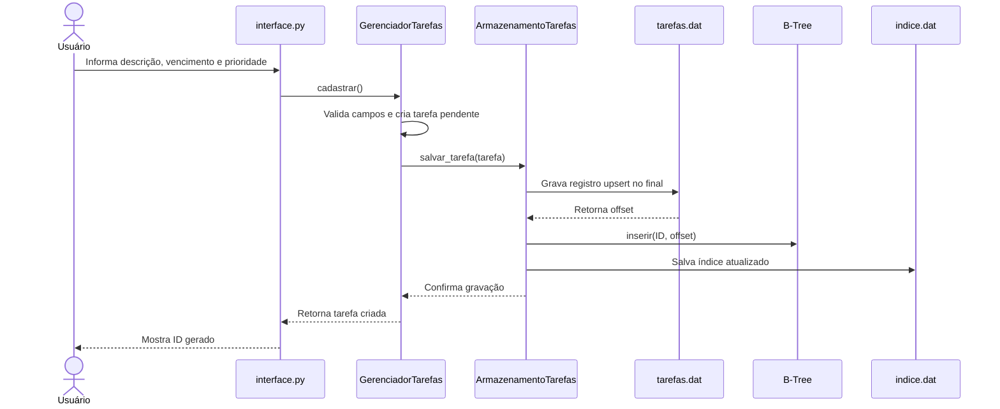
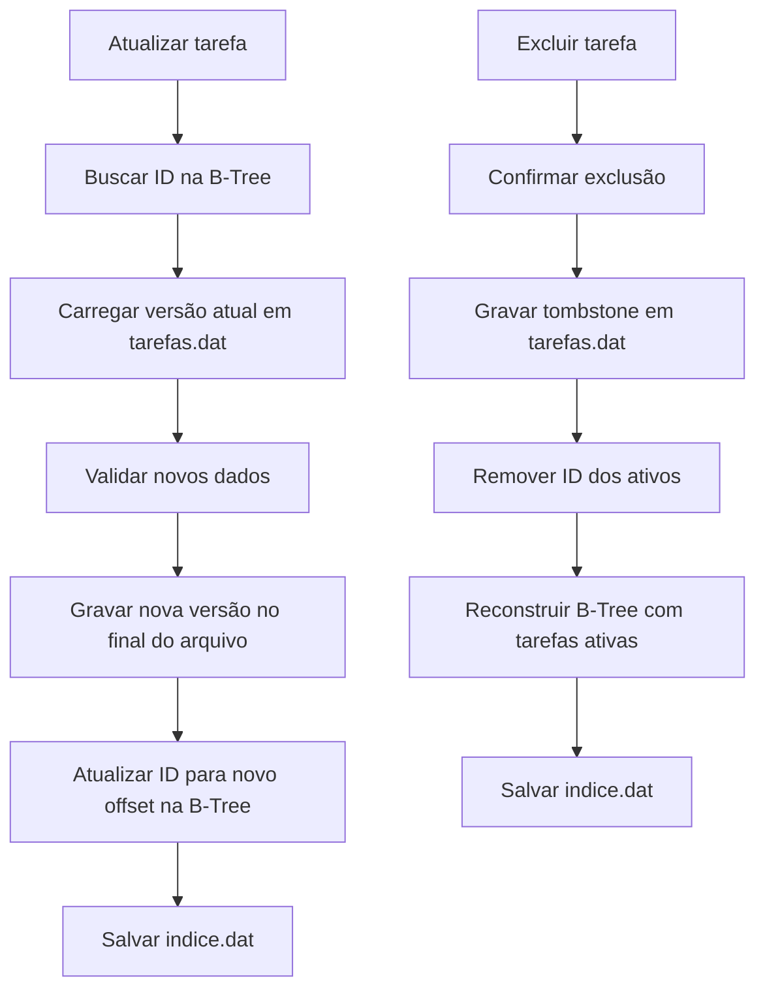
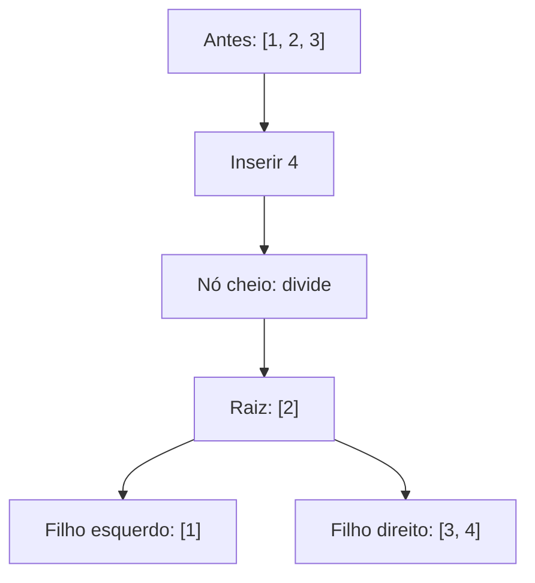

# Sistema de Gerenciamento de Tarefas com Mini Banco de Dados B-Tree

Projeto acadêmico em Python para cadastrar, consultar, listar, atualizar e excluir tarefas usando persistência em arquivos binários e um índice primário implementado com B-Tree.

O objetivo é mostrar que mesmo um sistema simples de tarefas pode usar ideias reais de estruturas de dados e bancos de dados.

## Alunos

Este projeto foi desenvolvido pelos alunos:

- Vini dos Santos Pereira - RM: 576935
- João Paulo Dias Ventura - RM: 575184
- Gustavo Henrique Lopes Rezende - RM: 574749

## Funcionalidades

- Cadastro de tarefas com ID automático.
- Descrição, data de vencimento, status e prioridade.
- Listagem geral em tabela no terminal.
- Filtros por status e data de vencimento.
- Busca direta por ID usando a B-Tree.
- Atualização de descrição, vencimento, status e prioridade.
- Exclusão com tombstone e reconstrução do índice.
- Visualização da B-Tree no terminal.
- Testes automatizados com `unittest`.

## Requisitos

- Python 3.10 ou superior.
- Nenhuma biblioteca externa.

## Como executar

```bash
python main.py
```

Para rodar os testes:

```bash
python -m unittest testes.py
```

## Organização dos arquivos

```text
gerenciador-tarefas/
|
|-- main.py
|-- tarefas.py
|-- persistencia.py
|-- btree.py
|-- interface.py
|-- testes.py
|-- README.md
|-- .gitignore
|
`-- dados/
    |-- tarefas.dat
    `-- indice.dat
```

- `main.py`: ponto de entrada do programa.
- `interface.py`: menu, entradas do usuário e tabelas no terminal.
- `tarefas.py`: regras de cadastro, busca, atualização, exclusão e validações.
- `persistencia.py`: leitura e escrita dos arquivos binários.
- `btree.py`: implementação da B-Tree de grau mínimo `t = 2`.
- `testes.py`: testes simples de integração e estrutura de dados.

## Arquitetura do projeto

A arquitetura foi mantida simples de propósito. A interface conversa com o gerenciador de tarefas, que aplica as regras básicas do sistema. A camada de persistência grava os registros em arquivo binário e usa a B-Tree como índice primário.



### Responsabilidade de cada módulo



## Como nosso mini banco de dados funciona



O arquivo `tarefas.dat` é a fonte de verdade dos registros. Ele guarda eventos binários em sequência: inserções/atualizações do tipo `upsert` e exclusões do tipo `delete`.

O arquivo `indice.dat` guarda uma representação persistida do índice B-Tree. Esse índice relaciona:

```text
ID da tarefa -> offset dentro de tarefas.dat
```

Quando o usuário busca uma tarefa pelo ID, o programa consulta a B-Tree, descobre o offset do registro mais recente e usa `seek(offset)` para ir direto ao ponto certo do arquivo.

### Fluxo de cadastro



### Fluxo de atualização e exclusão



## B-Tree

A B-Tree foi implementada de verdade, com nós, chaves ordenadas, filhos, inserção e divisão de nós. O grau mínimo usado é `t = 2`, então cada nó pode ter no máximo 3 chaves.

Na teoria, a busca em uma B-Tree tem complexidade `O(log n)`, pois a árvore se mantém balanceada conforme cresce. Neste projeto, as escritas, a persistência do índice e a reconstrução após exclusões podem ter custos adicionais, porque a proposta é educacional e simplificada.

### Exemplo de crescimento da B-Tree

Com grau mínimo `t = 2`, um nó aceita no máximo 3 chaves. Quando uma quarta chave precisa entrar em um nó cheio, ocorre uma divisão.



## Por que usar B-Tree?

B-Trees são muito usadas em bancos de dados e sistemas de arquivos porque mantêm os dados ordenados e permitem buscas eficientes. Aqui ela funciona como índice primário das tarefas, mostrando de forma prática como um banco pode localizar um registro sem percorrer todos os dados.

## Atualização e exclusão

As atualizações usam estratégia append-only: a nova versão da tarefa é gravada no final de `tarefas.dat`, e o índice passa a apontar para o novo offset.

As exclusões gravam um tombstone, ou seja, um registro informando que aquele ID foi removido. Depois disso, o índice é reconstruído apenas com as tarefas ativas. Essa simplificação evita implementar o algoritmo completo de remoção e rebalanceamento da B-Tree, que seria complexo demais para o objetivo do primeiro semestre.

Ao reiniciar, o programa lê `tarefas.dat` do início ao fim para recuperar o estado correto: versões antigas são ignoradas quando existe uma versão mais nova, e tarefas removidas não voltam a aparecer.

## Exemplo de uso

1. Escolha `[1] Cadastrar tarefa`.
2. Informe a descrição `Estudar B-Tree`.
3. Informe o vencimento `20/10/2026`.
4. Escolha a prioridade `alta`.
5. O sistema gera um ID, por exemplo `1`.
6. Escolha `[3] Buscar tarefa por ID`.
7. Digite `1`.
8. O sistema pesquisa o ID na B-Tree, usa o offset encontrado e exibe a tarefa.

## Visualização do índice

A opção `[7] Visualizar índice B-Tree` exibe os nós da árvore com indentação e mostra:

- altura da árvore;
- quantidade de nós;
- total de chaves;
- quantidade de divisões feitas durante inserções.

Isso ajuda a explicar para o professor como a árvore cresce e como as chaves ficam organizadas.

## Limitações

- Não é um banco de dados real de produção.
- Não possui transações completas, WAL ou recuperação sofisticada de falhas.
- A exclusão não usa o algoritmo completo de remoção da B-Tree.
- O arquivo `tarefas.dat` cresce com versões antigas e tombstones.
- `pickle` foi usado por simplicidade acadêmica e não deve ser usado para carregar arquivos desconhecidos.
